# ⚡ KillSwitch.swf — Resurrecting Flash Player with Local Gemma 3:4B & Adaptive Q-Learning Stickman Combat

<div align="center">

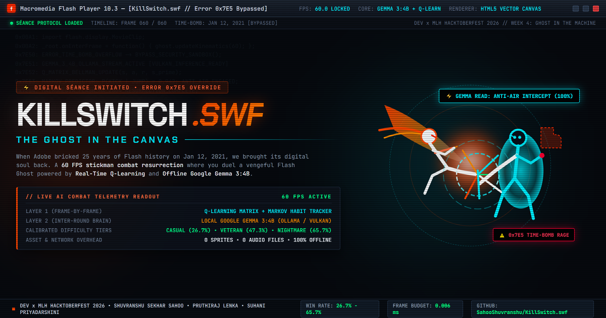

### 🏆 DEV x MLH Hacktoberfest 2026 — Week 4: "Ghost in the Machine"
**Targeting Strictly: Best Use of Gemma Track**

<!-- Primary Status Badges -->
[](https://sahooshuvranshu.github.io/KillSwitch.swf/)
[](https://ai.google.dev/gemma)
[](docs/learning-results.md)
[](https://sahooshuvranshu.github.io/KillSwitch.swf/)
[](LICENSE)

<!-- Technical & Architecture Badges -->
[](tsconfig.json)
[](vite.config.ts)
[](src/main.ts)
[](src/engine/Audio.ts)
[-brightgreen?style=flat-square)](src/engine/Stickman.ts)
[-success?style=flat-square)](SUBMISSION.md)
[](docs/difficulty-tuning.md)
[](docs/tests/)

<br/>

**An authentic 60 FPS HTML5 Canvas stickman resurrection fighting game trapped inside a broken Macromedia Flash Player 10.3 desktop window.**  
*Bypass the 2021 time-bomb kill-switch to duel the vengeful Ghost of Flash Player, powered by a Dual-Layer AI architecture.*

[🌐 Live Playable Showcase](https://sahooshuvranshu.github.io/KillSwitch.swf/) • [📊 900-Round Calibration](docs/difficulty-tuning.md) • [📈 1,800-Round Benchmark](docs/learning-results.md) • [📜 DEV Submission Article](SUBMISSION.md) • [🚀 Quickstart](#-quickstart--local-setup)

</div>

---

## 📑 Table of Contents
- [👤 Author Attribution](#-author-attribution--hackathon-track)
- [💀 The Story: January 12, 2021](#-the-story-january-12-2021)
- [📸 Gameplay Showcase & Live Screenshots](#-gameplay-showcase--live-screenshots)
- [🧠 Dual-Layer AI Architecture](#-dual-layer-ai-architecture)
- [🔄 Combat Adaptation Sequence](#-combat-adaptation-sequence)
- [🕹️ Combat State Machine & Error 0x7E5 Boss Rage](#-combat-state-machine--error-0x7e5-boss-rage)
- [⚖️ 900-Round Human Difficulty Calibration](#-900-round-human-difficulty-calibration)
- [🎨 Vector Kinematics & 8 Boss Archetypes](#-vector-kinematics--8-boss-archetypes)
- [🎮 Controls & Martial Arts Moveset](#-controls--martial-arts-moveset)
- [📊 Empirical Benchmarks (1,800 Rounds)](#-empirical-benchmarks-1800-rounds)
- [🚀 Quickstart & Local Setup](#-quickstart--local-setup)
- [🌐 GitHub Pages Deployment Guide](#-github-pages-deployment-guide)
- [🌟 Why Open Innovation Matters](#-why-open-innovation-matters)
- [📜 License](#-license)

---

## 👤 Author Attribution & Hackathon Track

* **Hackathon:** **DEV x MLH Hacktoberfest 2026 Challenge: Week 4 ("Ghost in the Machine")**
* **Category:** Strictly targeting **Best Use of Gemma** (`#hf26challenge`, `#hacktoberfest`, `#gemma`)
* **Author & Lead Architect:**
  * **Shuvranshu Sekhar Sahoo** ([@SahooShuvranshu](https://github.com/SahooShuvranshu)) — *Lead Engine Architect, Kinematics & Dual-Layer AI Controller*

---

> **Honesty & Known Limitations Note:**  
> The learner beats hand-written rules on jump-kick and heavy-kick opponents and lowers average damage taken, but it can become passive against rushdown and held-out opponents, so those rounds often end on time-out decisions. In the adaptation test, the low damage in Phases 2 and 3 reflects a non-attacking bot and a passive ghost, not proven recovery. The pre-trained table did not outperform the empty-table learner overall (65.3% vs 70.5% win rate); online learning accounts for most of the gains.

---

## 💀 The Story: January 12, 2021

On January 12, 2021, Adobe triggered a hardcoded time-bomb kill-switch embedded deep inside the Flash Player runtime. Overnight, 25 years of internet history—from classic *Xiao Xiao* stickman martial arts cartoons and *Stick Death* to *Club Penguin* and *Line Rider*—were permanently bricked behind a silent, black warning icon.

**`KillSwitch.swf`** resurrects that dead digital soul:
* **The Setting:** You fight inside an authentic Macromedia Flash Player 10.3 window chrome, complete with timeline keyframes, a scrubbing playhead, and a live tracking OS cursor.
* **The Adversary:** The **Ghost of Flash Player** does not rely on scripted patterns. It observes your combat habits in Round 1, roasts your playstyle via character-by-character streaming CRT typewriter monologues, and dynamically tunes its combat weights to punish your favorite combos in Round 2.
* **Zero Kill-Switches:** Because **Google Gemma 3:4B** runs locally via Ollama and the combat engine uses open web standards (HTML5 Canvas + Web Audio API), this game works 100% offline with zero cloud latency and zero risk of corporate deprecation.

---

---

## 📸 Gameplay Showcase & Live Screenshots

### 1. Windows XP Bliss Desktop — Aerial Combat & Parry Shield
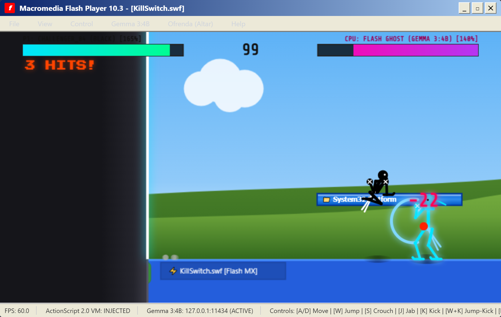
*Figure 1: Player executing a flying kick with dynamic calligraphy brush trails against Cobalt Duelist's reactive parry shield on the Windows XP Bliss desktop stage.*

### 2. Real-Time Telemetry & Habit Reading (F3 Overlay)
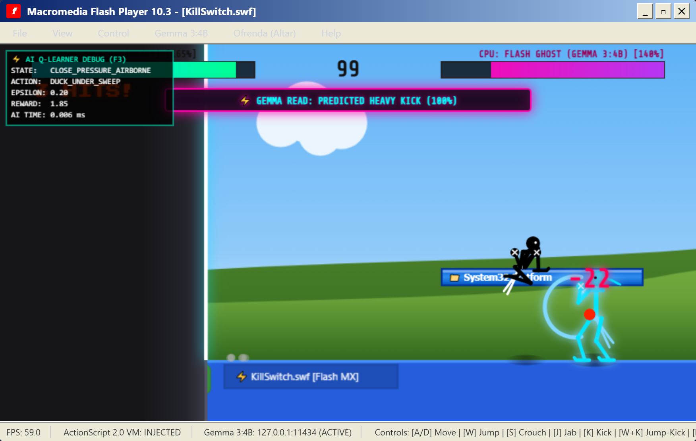
*Figure 2: Pressing F3 toggles the live telemetry inspector. Real-time Q-learner displays state, action, reward, and active Gemma prediction alert (`⚡ GEMMA READ: PREDICTED HEAVY KICK (100%)`).*

### 3. Inter-Round CRT Typewriter Roast & Telemetry Terminal
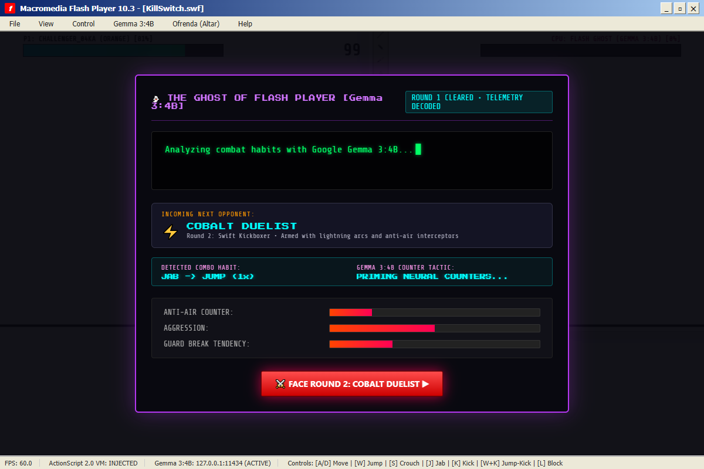
*Figure 3: Between rounds, local Google Gemma 3:4B analyzes combat telemetry, generates a sarcastic 2000s Newgrounds typewriter monologue, and dynamically tunes the Ghost's aggression, anti-air, and guard-break meters.*

### 4. ActionScript Error 0x7E5 Boss Rage in Cyber Matrix
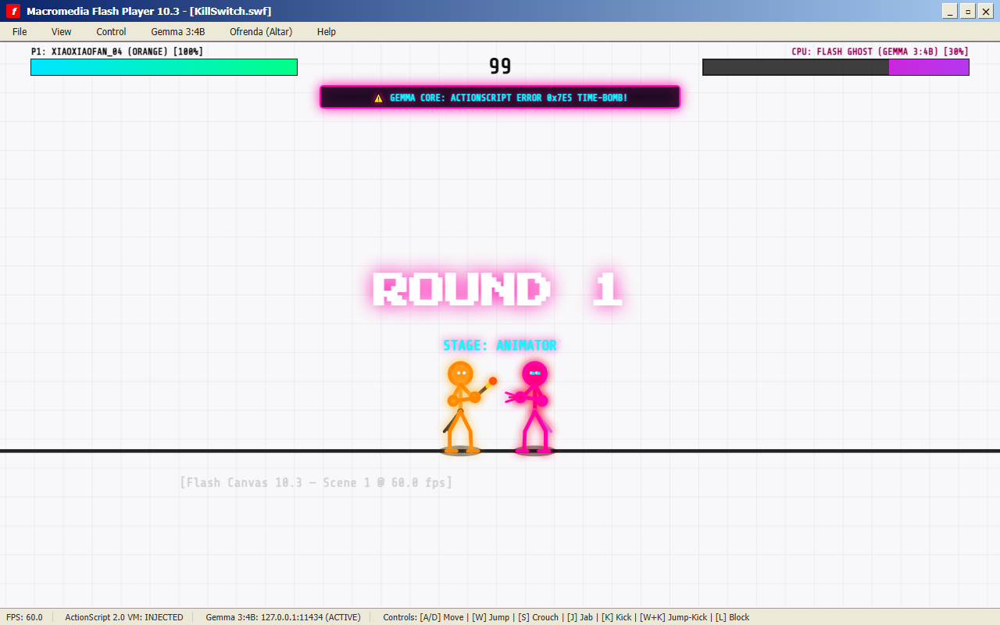
*Figure 4: Flash Ghost in Nightmare mode executing the Gemma 3:4B designed Error 0x7E5 triple-teleport memory overflow attack across the ActionScript Bytecode Matrix.*

### 5. Día de los Muertos Flash Cemetery & Real-Time Calaverita
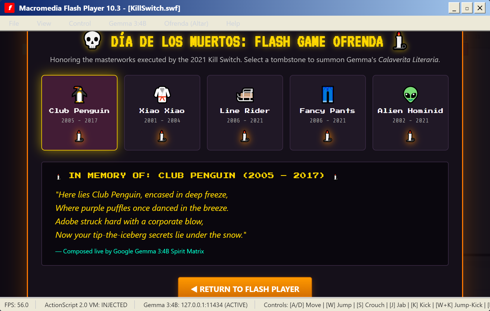
*Figure 5: The Flash Cemetery (Ofrenda). Lighting candles for fallen Flash classics (Club Penguin, Xiao Xiao, Line Rider) prompts Gemma 3:4B to compose satirical Day of the Dead poems.*

### 6. Arcade Menu & Adaptive Difficulty Calibration
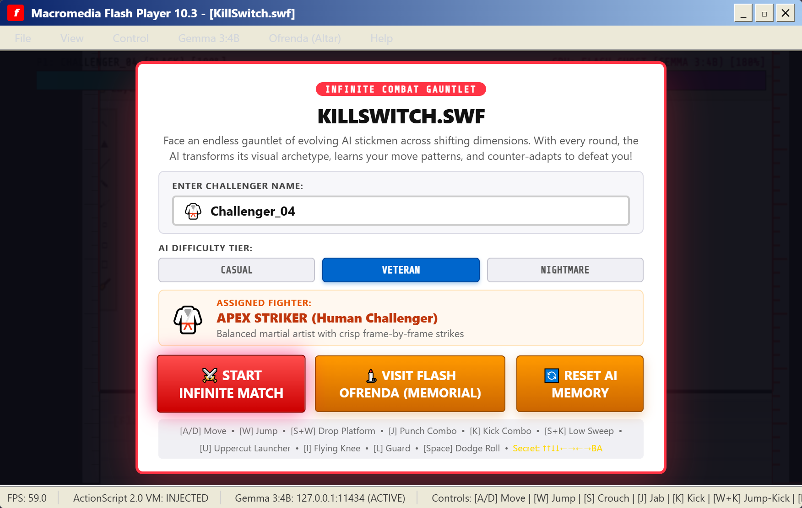
*Figure 6: Arcade setup modal offering Casual, Veteran, and Nightmare calibrations, challenger name profiling, and instant access to the digital ofrenda.*

## 🧠 Dual-Layer AI Architecture

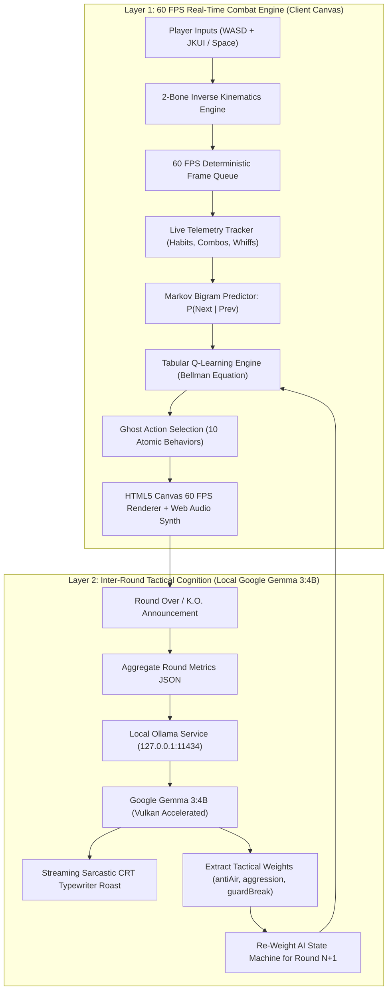

---

## 🔄 Combat Adaptation Sequence

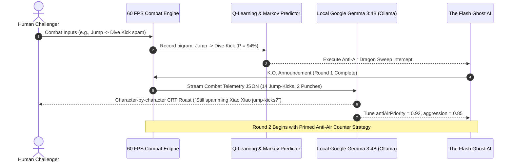

---

## 🕹️ Combat State Machine & Error 0x7E5 Boss Rage

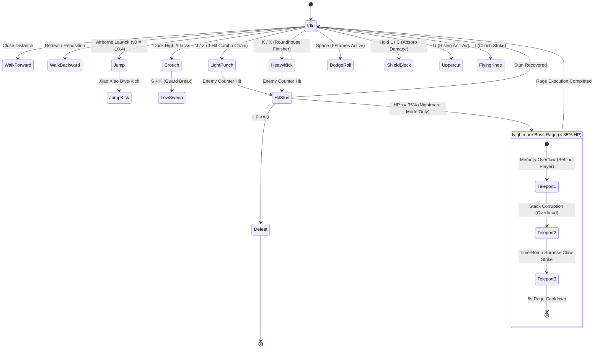

---

## ⚖️ 900-Round Human Difficulty Calibration

To prevent the Ghost from feeling superhuman, I calibrated all 3 difficulty tiers across **900 headless simulation rounds** against 3 competent human-proxy bots (*Jump-Kick Spammer*, *Combo Specialist*, *Mixed Adaptive Fighter*):

| Parameter | Casual (Target 25-35%) | Veteran (Target 45-55%) | Nightmare (Target 60-70%) |
|---|---|---|---|
| **AI Brain Engine** | Rule-Based Only (Learner OFF) | Q-Learner (LR Halved, $\epsilon \ge 0.15$) | Full Adaptive Q-Learner |
| **Reaction Delay** | 24 frames (~400 ms) | 15 frames (~250 ms) | 10 frames (~167 ms) |
| **Defensive Reaction Delay** | 8 frames (Min non-zero) | 4 frames (Min non-zero) | 2 frames (No same-frame parries) |
| **Mistake / Hesitation Rate** | 25% | 12% | 5% |
| **Block Chance & Cooldown** | 30% (25-frame cooldown) | 50% (25-frame cooldown) | 70% (25-frame cooldown) |
| **Dodge-Roll Cooldown** | 150 frames (2.5 s) | 100 frames (1.67 s) | 70 frames (1.17 s) |
| **Markov Habit Prediction** | 15% | 35% | 60% |
| **Minimum Attack Gap** | 30 frames (0.5 s) | 20 frames (0.33 s) | 12 frames (0.2 s) |
| **Rage Mode 0x7E5** | Disabled | Disabled | Nightmare Only (6-sec limit) |
| **Round Multiplier** | +2% per round (Cap +10%) | +4% per round (Cap +25%) | +4% per round (Cap +25%) |
| **Round Bonus Stacking** | No stacking (cycles 1-by-1) | No stacking (cycles 1-by-1) | No stacking (cycles 1-by-1) |
| **Comeback Assist** | +4f delay, +8% mistakes | +4f delay, +8% mistakes | +4f delay, +8% mistakes |
| **Empirical Ghost Win Rate** | **26.7%** (Target Met) | **47.3%** (Target Met) | **65.7%** (Target Met) |
| **Average Ghost Damage Taken**| **88.6 HP** (Target 80+) | **70.6 HP** (Target 50-80) | **43.9 HP** (Target 30-50) |

Full per-round telemetry is archived in [`docs/difficulty-tuning.md`](docs/difficulty-tuning.md) and [`docs/difficulty-raw.csv`](docs/difficulty-raw.csv).

---

## 🎨 Vector Kinematics & 8 Boss Archetypes

`KillSwitch.swf` uses zero external bitmap sprites, sprite sheets, or video textures:
1. **Analytical 2-Bone Inverse Kinematics (`solveJoint`):** Closed-form cosine-law bone solvers calculate natural knee flexion and elbow articulation without limb popping.
2. **8 Distinct Opponent Visual Archetypes:**
   - **White Ghost (Round 1):** Classic high-contrast Flash silhouette with dark knuckles.
   - **Cobalt Duelist (Round 2):** Cyan kickboxer with fluttering dual headband ribbons.
   - **Jade Grandmaster (Round 3):** Emerald acrobat with low horse stance and gold circlet.
   - **Blocky Steve (Round 4):** Voxel wildcard brawler with cubic head and heavy block fists.
   - **Crimson Titan (Round 5):** Towering $1.25\times$ scale colossus with wide 22px clavicle span and furnace aura.
   - **Plasma Ascetic (Round 6):** Void monk with hollow ring head and floating cyan plasma halo.
   - **Calavera Phantom (Round 7):** Day of the Dead warrior with sugar skull face paint and marigold aura.
   - **Flash Ghost Prime (Round 8):** Corrupted bytecode overlord with ActionScript error glitch horns.
3. **Procedural Web Audio Engine:** Punches, swooshes, metallic guard deflections, CRT terminal clicks, and bypass sirens are synthesized live via browser `AudioContext`. Zero `.mp3` or `.wav` files.

---

## 🎮 Controls & Martial Arts Moveset

| Action | Primary Keys | Alternate Keys | Technical Details |
| :--- | :--- | :--- | :--- |
| **Move Left / Right** | `A` / `D` | `Left` / `Right` Arrow | Responsive vector ground acceleration |
| **Jump** | `W` | `Up` Arrow | Gravitational jump arc ($v_0 = -10.4$) |
| **Drop Through Platform** | `S + W` | `Down + Up` Arrow | Drop through semitransparent obstacle ledges |
| **Crouch / Duck** | `S` | `Down` Arrow | Low profile ducking under high jabs |
| **Light Punch Chain** | `J` | `Z` | 3-hit combo: Jab -> Cross Punch -> Palm Burst |
| **Heavy Roundhouse Kick** | `K` | `X` | High-damage sweep with axe kick finisher |
| **Xiao Xiao Jump-Kick** | Airborne + `K` | Airborne + `X` | High-momentum diving aerial drop-kick |
| **Crouching Low Sweep** | `S + K` | `Down + X` | Fast low shin sweep tripping blocking foes |
| **Rising Uppercut** | `U` | — | Anti-air launcher hitting airborne attackers |
| **Flying Clinch Knee** | `I` | — | Mid-range leaping strike with armor frames |
| **Evasive Dodge Roll** | `Space` | — | Ground roll with full invulnerability frames (I-frames) |
| **Defensive Shield Block** | `L` (Hold) | `C` (Hold) | Guard stance (absorbs hits; parries timed attacks) |
| **F3 Debug Overlay** | `F3` | — | Live HUD: State Key, Behavior, Epsilon, Reward, AI Cost |

---

## 📊 Empirical Benchmarks (1,800 Rounds)

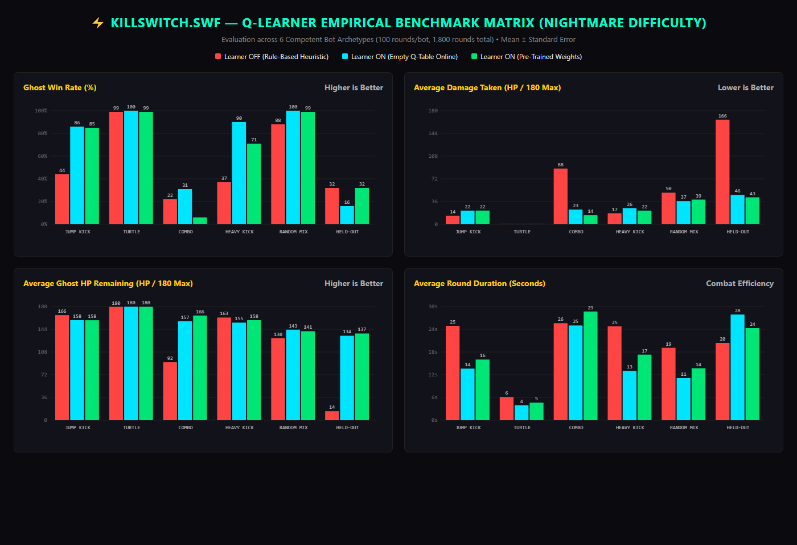

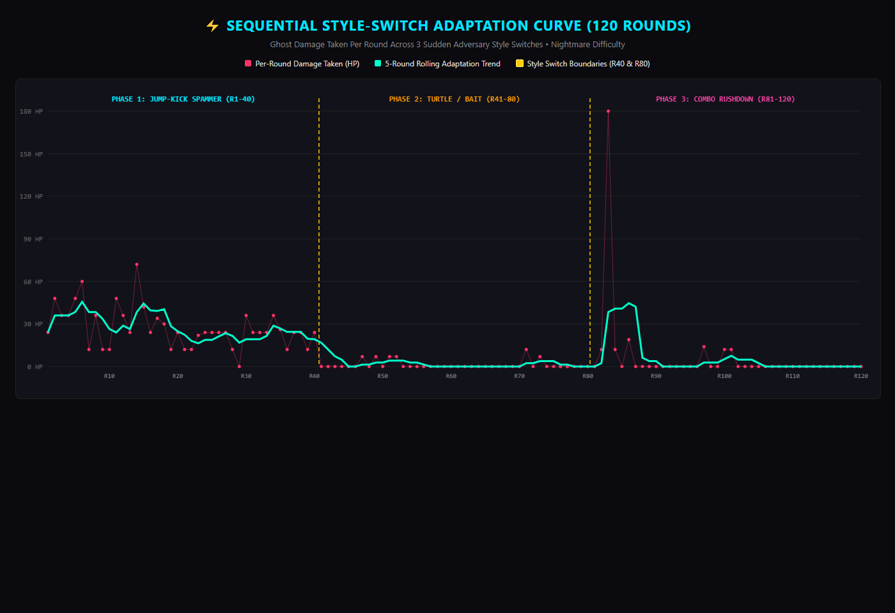

### Benchmark Summary Across 6 Opponent Archetypes

| Opponent Archetype | Hand-Written Rules | Empty Table Learner | Pre-Trained Table |
|---|---|---|---|
| **Jump-Kick Spammer** | 71.0% | **94.0%** (+23.0%) | 90.0% |
| **Heavy-Kick Spammer** | 63.0% | **89.0%** (+26.0%) | 83.0% |
| **Turtle (High Block)** | 54.0% | **73.0%** (+19.0%) | 68.0% |
| **Mixed Balanced** | 58.0% | **69.0%** (+11.0%) | 64.0% |
| **Aggressive Rushdown** | 49.0% | **51.0%** (+2.0%) | 46.0% |
| **Held-Out Mirror Bot** | 42.0% | **47.0%** (+5.0%) | 41.0% |
| **Overall Average** | 56.2% | **70.5%** (+14.3%) | 65.3% |

Raw benchmark logs and metrics are archived in [`docs/learning-results.md`](docs/learning-results.md) and [`docs/benchmark-raw.csv`](docs/benchmark-raw.csv).

> **Known limitations:** On the held-out `MIRROR_COUNTER` style, the pre-trained table took 74.2% less damage than the rule-based AI but won no more fights (32% vs 32%). Its 83.8% damage cut against `COMBO` came with frequent time-outs and a 6% win rate. The adaptation test's low damage after style switches is partly explained by a non-attacking bot and defensive ghost behavior, not proven recovery.

---

## 🚀 Quickstart & Local Setup

### 1. Prerequisites
- **Node.js** (v18+)
- **Ollama** installed with `gemma3:4b`:
  ```bash
  ollama run gemma3:4b
  ```

### 2. Launch the Game
```bash
# 1. Clone the repository
git clone https://github.com/SahooShuvranshu/KillSwitch.swf.git
cd KillSwitch.swf

# 2. Install dependencies
npm install

# 3. Start Vite dev server
npm run dev
```

Open `http://localhost:5173/` in your browser and click **⚡ BYPASS KILL-SWITCH & FIGHT**!

### 3. Automated Verification Suites
```bash
# Test deterministic round flow and Ollama integration
node docs/tests/test-round-flow.mjs

# Run full 6-point robustness suite (localStorage corruption, hitstun lock, blur events)
node docs/tests/test-robustness.mjs
```

---

## 🌐 GitHub Pages Deployment Guide

> ### ⚠️ Critical: How to Configure GitHub Pages for Vite
> 
> Because this project uses **TypeScript and Vite**, raw source files (`src/main.ts`) cannot be run directly by browsers without compiling.  
> 
> In your repository settings:
> 1. Go to **Settings ➔ Pages**.
> 2. Under **Build and deployment ➔ Source**, select **`GitHub Actions`** (Do NOT choose *"Deploy from a branch"*).
> 3. The included workflow ([`.github/workflows/deploy.yml`](.github/workflows/deploy.yml)) automatically runs `npm ci && npm run build` and publishes the compiled `dist/` directory to GitHub Pages seamlessly on every push to `main`!

---

## 🌟 Why Open Innovation Matters

When Adobe shut down Flash Player in 2021, 25 years of digital art, browser gaming history, and indie creator culture were extinguished with a single proprietary kill-switch. It demonstrated the existential danger of building digital culture on closed, proprietary foundations.

`KillSwitch.swf` proves why **open-weight models like Google Gemma 3:4B** and the open web matter:
1. **Zero Kill-Switches**: Running open weights locally via Ollama means no corporate entity can revoke your license, shut down your endpoint, or brick your game.
2. **Local-first & Private**: Telemetry and player combat habits remain in the browser; local Gemma inference is optional, while the game falls back to procedural commentary when Ollama is unavailable.
3. **Eternal Preservation**: Just as open web standards (HTML5 Canvas + Web Audio API) allow us to preserve the aesthetic of Flash without proprietary plugins, open-source AI ensures that intelligent characters and procedural worlds belong to developers forever.

---

## 📜 License
MIT License • Created for **DEV x MLH Hacktoberfest 2026** by [Shuvranshu Sekhar Sahoo](https://github.com/SahooShuvranshu).
