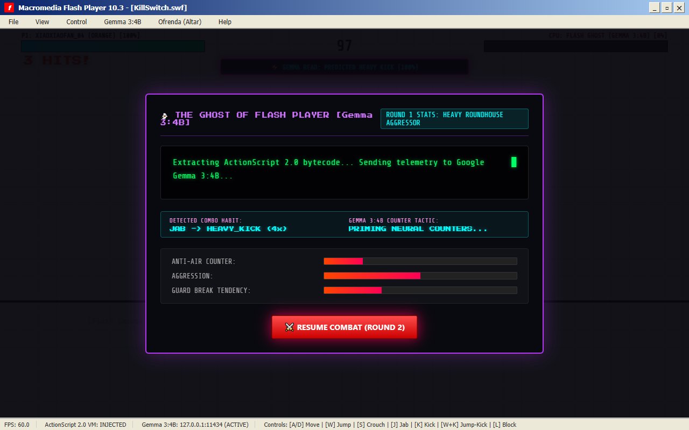
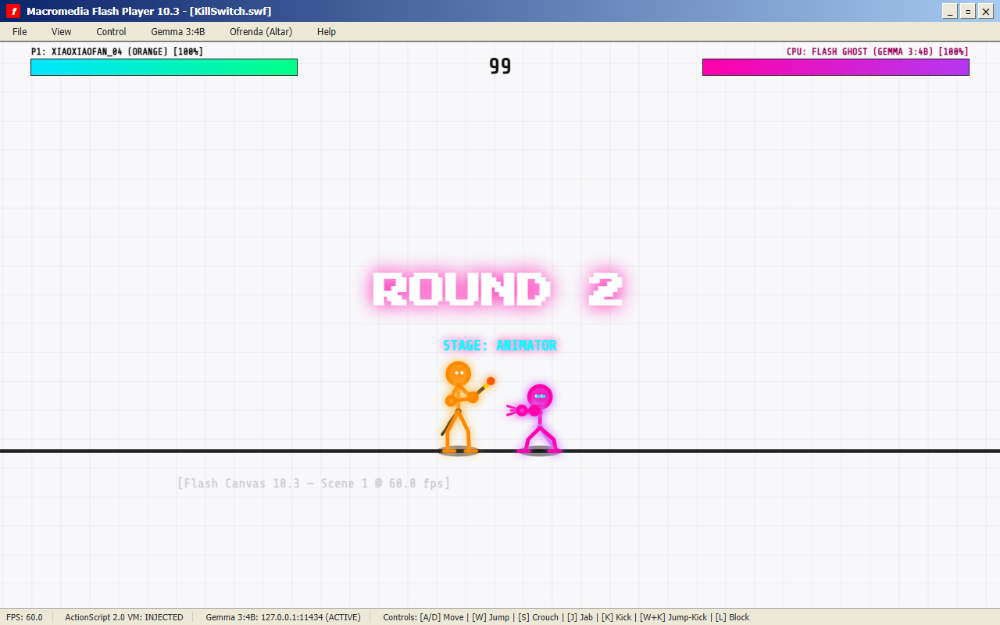
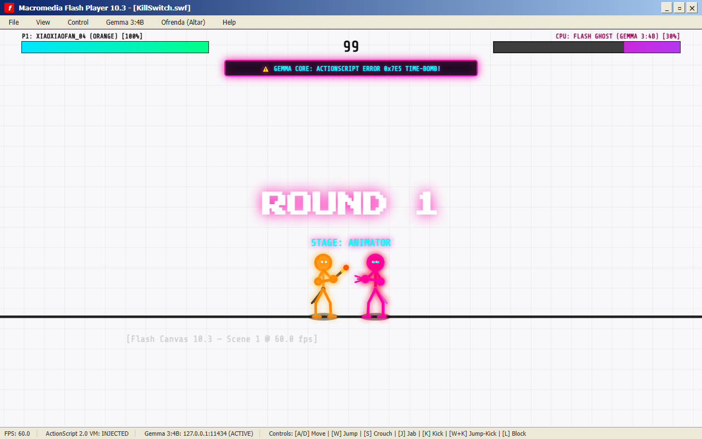

*This article is submitted for the **DEV x MLH Hacktoberfest 2026 Challenge: Week 4 ("Ghost in the Machine")** targeting the **Best Use of Gemma** and **Overall Grand Prize**.*

---

## 💀 The Hook: January 12, 2021

On January 12, 2021, Adobe triggered a hardcoded time-bomb kill-switch embedded deep inside the Flash Player runtime. 

Almost overnight, twenty-five years of internet culture—from classic *Xiao Xiao* stickman martial arts cartoons and *Club Penguin* to *Line Rider* and *Alien Hominid*—were permanently bricked behind a silent, black warning icon. The plugin refused to load. The animations stopped. The music went silent.

For this week's **"Ghost in the Machine"** challenge, I wanted to resurrect that dead digital soul.

Meet **`KillSwitch.swf`**: a 60 FPS HTML5 Canvas stickman fighting game trapped inside a cracked Macromedia Flash Player 10.3 desktop window. You play as a rogue stickman fighter who breaches the 2021 kill-switch dialog to duel the **Ghost of Flash Player** itself.

The Ghost is not a pre-scripted dummy bot. It is powered locally by **Google Gemma 3 4B** via Ollama:
- **Real-Time Combat Habit Learning**: A Markov bigram sequence predictor tracks your live combo transitions (e.g., $P(\text{Heavy Kick} \mid \text{Jab})$, $P(\text{Jump Kick} \mid \text{Jump})$). When you fall into predictable habits, the Flash Ghost anticipates your next button press in real time, triggering **Matrix Parries**, **Anti-Air Dragon Sweeps**, and floating HUD alerts like `⚡ GEMMA READ: PREDICTED HEAVY KICK (100%)`.
- **Inter-Round Tactical Monologues**: Between rounds, Gemma streams a spoken monologue roasting your specific combo patterns with authentic 2000s Newgrounds lore and adapts its AI state machine (`antiAirPriority`, `aggression`, `guardBreakRate`).
- **Gemma-Designed Boss Rage Mechanic ("ActionScript Error 0x7E5 Time-Bomb")**: When the Ghost's health drops below 35%, it enters an unhinged rage state, triggering a triple-teleport memory overflow attack designed directly by Gemma 3:4B.
- **Flash Cemetery Ofrenda**: In the spirit of **Día de los Muertos**, lighting candles at the graves of fallen Flash legends prompts Gemma 3:4B to compose satirical *calaveritas literarias* (Day of the Dead rhyming epitaph poems).

---

## 🎮 What I Built

`KillSwitch.swf` combines early-2000s web nostalgia with modern browser tech and cutting-edge local edge AI:

1. **60 FPS Procedural Stickman Combat Engine & Variable Statures**:
   - Zero sprite sheets: Every limb, joint, and torso of the player and Flash Ghost is rendered procedurally with dynamic skeletal kinematics on an HTML5 `<canvas>`.
   - Distinct Fighter Archetypes & Variable Sizes:
     - **Apex Striker (Orange)**: Athletic martial artist wielding the artist stylus with flowing calligraphy ink slash trails.
     - **Plasma Ascetic**: Lithe martial artist with signature hollow-ring head and glowing cyan plasma aura.
     - **Crimson Titan**: Towering heavyweight brawler (128% stature, heavy bone thickness) with twin crimson energy blades.
     - **Azure Speedster & Jade Acrobat**: Compact, agile rushers (85% stature) with rapid low-profile hops.
     - **Xiao Xiao Grandmaster**: Classic martial artist with flowing red headband ribbons.
   - Moveset & game juice: Dynamic camera zoom (1.0x to 1.28x), motion afterimages, inverted impact flash frames, floating damage numbers, combo counter, and slow-mo K.O. freeze-frames.
2. **Automatic Multi-Round Scene Shifts & Flash MX 2004 Window Chrome**:
   - **Scene Automatically Changes Every Round**:
     - *Round 1*: **Flash Studio Canvas** — Brawling directly inside Macromedia Flash with the top Timeline ruler, keyframe tracks, red scrubbing playhead, left Tools palette, and a **giant floating virtual mouse cursor (`↖`)** actively tracking the fighters!
     - *Round 2*: **Windows XP Bliss Desktop** — Rolling green grass hills, azure sky, retro desktop icons, and blue taskbar serving as the floor.
     - *Round 3*: **ActionScript Cyber Matrix** — Raining green bytecode streams and glowing digital floor.
     - *Round 4*: **2021 Kill-Switch Void** — Deep obsidian void with the broken Flash puzzle icon.
     - *Round 5*: **Día de los Muertos Altar** — Marigold petals and flickering memorial candles.
   - Interactive 2021 time-bomb kill-switch bypass flow.
3. **Procedural 8-Bit Web Audio Engine**:
   - No external `.mp3` or `.wav` files. All punches, whooshes, bone-crunch kicks, metallic guard deflections, and CRT terminal typewriter clicks are synthesized live in milliseconds using the browser's native `AudioContext`.
4. **The Día de los Muertos Flash Cemetery (Ofrenda)**:
   - An interactive memorial altar with cempasúchil marigold orange aesthetics and flickering candles honoring *Club Penguin* (2005-2017), *Xiao Xiao* (2001-2004), *Line Rider* (2006-2021), *Fancy Pants Adventures* (2006-2021), and *Alien Hominid* (2002-2021).

---

## 🧠 How Google Gemma 3:4B Powers the Ghost

Instead of relying on cloud APIs with network latency, `KillSwitch.swf` runs **Google Gemma 3 4B completely offline** on consumer hardware (Intel i5-8265U + NVIDIA GeForce MX250) using Ollama with Vulkan acceleration.

### The Telemetry & Combat Adaptation Loop

```
+-------------------------------------------------------------------------+
| ROUND 1: Player Combats the Ghost                                        |
| -> TelemetryTracker silently records: jumpKicks, punches, blocks, whiff |
+-------------------------------------------------------------------------+
                                    |
                                    v [K.O. Announcement]
+-------------------------------------------------------------------------+
| RETRO FLASH CRT TYPEWRITER TERMINAL                                     |
| -> Client streams HTTP POST to local Ollama (127.0.0.1:11434)           |
| -> Model: gemma3:4b with strict system prompt & JSON schema            |
+-------------------------------------------------------------------------+
                                    |
                                    v [Token-by-Token Streaming]
+-------------------------------------------------------------------------+
| 1. Sarcastic Lore Roast: Types out character-by-character on screen     |
| 2. Parameter Extraction: antiAirPriority, aggression, guardBreakRate   |
+-------------------------------------------------------------------------+
                                    |
                                    v
+-------------------------------------------------------------------------+
| ROUND 2: Adapted AI State Machine                                       |
| -> If player spammed jump-kicks, Ghost intercepts with dragon-punches   |
| -> If player turtled behind block, Ghost initiates guard-break sweeps   |
+-------------------------------------------------------------------------+
```

### The System Prompt & Protocol

Between rounds, the game issues a structured inference prompt to Gemma:

```json
{
  "model": "gemma3:4b",
  "system": "You are the vengeful Ghost of Adobe Flash Player (executed Jan 12, 2021). You speak in sarcastic 2000s Newgrounds slang and ActionScript 2.0 metaphors. Analyze the player's round metrics and output a JSON block with: 1) 'roast': 2-sentence sarcastic monologue, 2) 'antiAirPriority': float 0.1-0.95, 3) 'aggression': float 0.2-0.95, 4) 'guardBreakRate': float 0.1-0.9.",
  "prompt": "Round 1 Combat Telemetry for 'XiaoXiaoFan_04': Jump-Kicks: 14, Punches: 2, Blocks: 1, Damage Dealt: 88, Dominant Style: 'Xiao Xiao Airborne Jump-Spammer'.",
  "stream": true
}
```

### The In-Game Adaptation

If you spam flying jump-kicks or predictable jab-into-kick chains in Round 1:
- Gemma streams a natural, cynical in-character spoken monologue:
  > *"Still spamming jump-kicks like this is Xiao Xiao 3? I survived Steve Jobs' open letter in 2010; your airborne spam won't survive Round 2. Anti-air protocol loaded!"*
- Gemma tunes `antiAirPriority = 0.92`, `aggression = 0.85`, and primes the `ANTI_AIR` counter tactic.
- The UI displays an adaptation card:
  - **DETECTED COMBO HABIT:** `JUMP -> JUMP_KICK (5x)`
  - **GEMMA 3:4B COUNTER TACTIC:** `ANTI_AIR`
- In Round 2, the AI immediately predicts your habits in real time. Whenever you jump, it ducks under and launches a rising dragon kick to knock you out of the sky, flashing a live combat alert:
  `⚡ GEMMA READ: ANTI-AIR INTERCEPT!`


*Figure 1: Gemma 3:4B analyzing real-time combat habits and locking in tactical counters between rounds.*


*Figure 2: The Flash Ghost in Round 2, executing an anti-air duck-under counter.*

### Gemma-Designed Boss Mechanic: "ActionScript Error 0x7E5 Time-Bomb"

When the Ghost's health drops below 35%, it enters an unhinged rage state designed directly by **Google Gemma 3 4B**:
1. **Trigger Alert**: The Flash Ghost's aura turns radiant crimson (`#ff0033`), accompanied by an audible digital bypass surge:
   `⚠️ GEMMA CORE: ACTIONSCRIPT ERROR 0x7E5 TIME-BOMB!`
2. **Triple Teleport Memory Overflow**:
   - **Step 1 (0ms)**: Glitches behind the player with a memory overflow alert (`⚠️ 0x7E5: TELEPORT [1/3] MEMORY OVERFLOW`).
   - **Step 2 (140ms)**: Glitches 120px directly overhead into the ceiling (`⚠️ 0x7E5: TELEPORT [2/3] STACK CORRUPTION`).
   - **Step 3 (280ms)**: Drops down directly behind the player's back and unleashes an unblockable heavy claw strike (`⚠️ 0x7E5: TIME-BOMB SURPRISE CLAW EXECUTION!`).


*Figure 3: Flash Ghost executing the Gemma 3:4B designed Error 0x7E5 triple-teleport strike.*

### Día de los Muertos: Gemma's Calaveritas Literarias

When a player visits the Flash Cemetery and clicks a gravestone, Gemma 3 4B composes an on-the-fly *calaverita literaria*:

> *Here lies Club Penguin, swallowed by the corporate sand,*  
> *A million childhood hours resting in La Catrina's hand.*  
> *Though Adobe struck the kill-switch and dimmed the raster light,*  
> *Your waddling puffles dance through the digital night. 🕯️*

---

## 🌟 Why Open Innovation Matters

The Hacktoberfest Week 4 prompt asks participants: *“Tell us why open innovation matters for what you built. Does running your own model mean your project works with the lights (and the internet) off? Make sure what you build isn't locked inside a service that might disappear someday?”*

This question is the core philosophy behind `KillSwitch.swf`.

Flash Player died because it was **closed-source and proprietary**. A single corporation held the master encryption keys, the browser plugins, and the execution switch. When Adobe decided it was no longer financially advantageous to support Flash, they didn't just stop updating it—they actively triggered a remote software execution kill-switch that wiped twenty-five years of independent digital art and human creativity off the internet.

`KillSwitch.swf` represents the antidote to the corporate kill-switch:

1. **Zero Kill-Switches with Open Weights**: Because **Google Gemma 3 4B** is an open-weight model running locally through Ollama, no company can ever remotely shut down this game's intelligence. No API deprecation, no sudden price hike, and no Terms of Service change can revoke the Ghost's brain.
2. **100% Offline & Sovereignty**: The game requires zero internet connection. In the middle of nowhere, with the Wi-Fi disabled and the lights out, Gemma still analyzes telemetry, writes calaveritas, and adapts to your fighting style at 60 FPS.
3. **Open Standards vs. Proprietary Plugins**: By rewriting the Flash stickman experience in open HTML5 Canvas and native Web Audio API, we prove that open web standards and open AI models can preserve, resurrect, and elevate creative history forever.

---

## 📦 Source Code & How to Play

The complete open-source project is available on GitHub:

🔗 **Repository:** [https://github.com/SahooShuvranshu/KillSwitch.swf](https://github.com/SahooShuvranshu/KillSwitch.swf)

### 30-Second Local Quickstart

```bash
# 1. Pull and serve Gemma 3 4B locally via Ollama
ollama pull gemma3:4b
ollama serve

# 2. Clone and run KillSwitch.swf
git clone https://github.com/SahooShuvranshu/KillSwitch.swf.git
cd KillSwitch.swf
npm install
npm run dev
```

Visit `http://localhost:5173/` in any modern browser, enter your name, and click **⚡ BYPASS KILL-SWITCH & FIGHT**!

---

*Long live the Flash generation. And long live open-source AI.*
