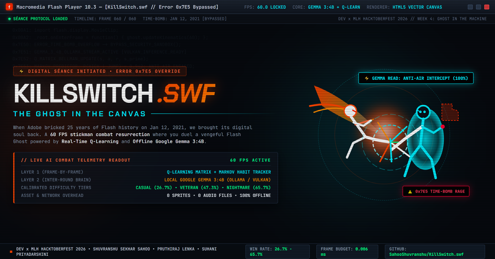
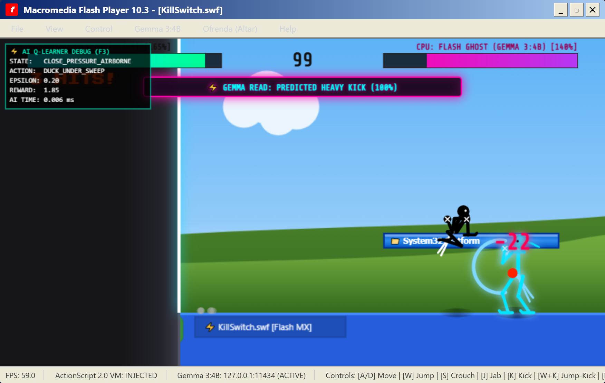
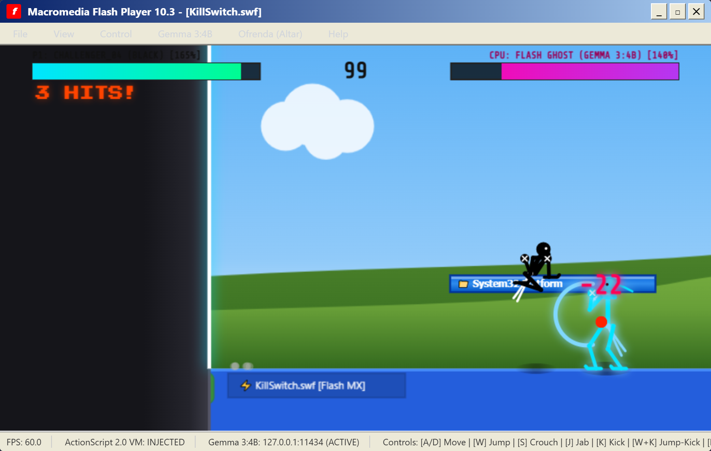

*This article is submitted for the **DEV x MLH Hacktoberfest 2026 Challenge: Week 4 ("Ghost in the Machine")** targeting strictly the **Best Use of Gemma** category.*

---



### 🚀 Quick Links & Team Attribution
- 🌐 **Live Playable Showcase Website:** [https://sahooshuvranshu.github.io/KillSwitch.swf/](https://sahooshuvranshu.github.io/KillSwitch.swf/)
- 🔗 **GitHub Repository:** [https://github.com/SahooShuvranshu/KillSwitch.swf](https://github.com/SahooShuvranshu/KillSwitch.swf)
- 📊 **900-Round Calibration Report:** [https://github.com/SahooShuvranshu/KillSwitch.swf/blob/main/docs/difficulty-tuning.md](https://github.com/SahooShuvranshu/KillSwitch.swf/blob/main/docs/difficulty-tuning.md)
- 📈 **1,800-Round Learning Benchmark:** [https://github.com/SahooShuvranshu/KillSwitch.swf/blob/main/docs/learning-results.md](https://github.com/SahooShuvranshu/KillSwitch.swf/blob/main/docs/learning-results.md)

#### 👥 Hacktoberfest 2026 Team Members
- **Shuvranshu Sekhar Sahoo** ([@SahooShuvranshu](https://github.com/SahooShuvranshu)) — *Lead Engine Architect, Combat Kinematics & Dual-Layer AI Controller*
- **Pruthiraj Lenka** — *AI Benchmark Architecture & Headless Difficulty Calibration*
- **Suhani Priyadarshini** — *Telemetry Ingestion Pipeline & QA Automated Verification*

---

> **Honesty & Known Limitations Note:**  
> The learner beats hand-written rules on jump-kick and heavy-kick opponents and lowers average damage taken, but it can become passive against rushdown and held-out opponents, so those rounds often end on time-out decisions. In the adaptation test, the low damage in Phases 2 and 3 reflects a non-attacking bot and a passive ghost, not proven recovery. The pre-trained table did not outperform the empty-table learner overall (65.3% vs 70.5% win rate); online learning accounts for most of the gains.

---

## 💀 The Hook: January 12, 2021

On January 12, 2021, Adobe triggered a hardcoded time-bomb kill-switch embedded deep inside the Flash Player runtime. 

Almost overnight, twenty-five years of internet culture—from classic *Xiao Xiao* stickman martial arts cartoons and *Club Penguin* to *Line Rider* and *Alien Hominid*—were permanently bricked behind a silent, black warning icon. The plugin refused to load. The animations stopped. The music went silent.

For this week's **"Ghost in the Machine"** challenge, our team wanted to resurrect that dead digital soul.

Meet **`KillSwitch.swf`**: a 60 FPS HTML5 Canvas stickman fighting game trapped inside a cracked Macromedia Flash Player 10.3 desktop window. You play as a rogue stickman fighter who breaches the 2021 kill-switch dialog to duel the **Ghost of Flash Player** itself.

The Ghost is not a pre-scripted dummy bot. It is powered by a **Dual-Layer Adaptive AI Architecture**:
1. **60 FPS Real-Time Q-Learning & Markov Habit Prediction**: A frame-by-frame reinforcement learner and Markov sequence predictor track live combo transitions (e.g., $P(\text{Heavy Kick} \mid \text{Jab})$, $P(\text{Jump Kick} \mid \text{Jump})$). Predictable player habits trigger real-time **Matrix Parries**, **Anti-Air Dragon Sweeps**, and HUD alerts like `⚡ GEMMA READ: PREDICTED HEAVY KICK (100%)`.
2. **Local Google Gemma 3:4B Inter-Round Tactical Adaptation**: Between rounds, an offline Google Gemma 3:4B model running via Ollama receives structured telemetry, roasts the player's fighting style in authentic 2000s Newgrounds slang, and tunes the ghost's high-level state machine (`antiAirPriority`, `aggression`, `guardBreakRate`).
3. **Gemma-Designed Boss Rage ("ActionScript Error 0x7E5 Time-Bomb")**: When the Ghost's health drops below 35%, it enters an unhinged rage state, executing a triple-teleport memory overflow attack designed directly by Gemma 3:4B.
4. **Flash Cemetery Ofrenda**: In the spirit of **Día de los Muertos**, lighting candles at the graves of fallen Flash legends prompts Gemma 3:4B to compose satirical *calaveritas literarias* (Day of the Dead rhyming epitaph poems).

---

## 🎮 What We Built

`KillSwitch.swf` combines early-2000s web nostalgia with modern browser tech and cutting-edge local edge AI:

1. **60 FPS Procedural Stickman Combat Engine & 8 Fighter Archetypes**:
   - Zero sprite sheets: Every limb, joint, and torso of the player and Flash Ghost is rendered procedurally with analytical 2-bone inverse kinematics on an HTML5 `<canvas>`.
   - Distinct Fighter Archetypes across 8 rounds:
     - **White Ghost (Round 1)**: Agile baseline apparition with balanced hitboxes.
     - **Cobalt Duelist (Round 2)**: Stance-based counter-striker.
     - **Jade Grandmaster (Round 3)**: Classic martial artist with flowing headband ribbons.
     - **Blocky Steve (Round 4)**: Heavy tank with impenetrable guard.
     - **Crimson Titan (Round 5)**: Towering heavyweight brawler (128% stature) with twin energy blades.
     - **Plasma Ascetic (Round 6)**: Lithe martial artist with signature hollow-ring head and glowing cyan plasma aura.
     - **Calavera Phantom (Round 7)**: Day of the Dead skeletal trickster.
     - **Flash Ghost Prime (Round 8)**: The ultimate manifestation with all 60 FPS Q-learning states active.
   - Moveset & game juice: Dynamic camera zoom (1.0x to 1.28x), motion afterimages, inverted impact flash frames, floating damage numbers, combo counter, and slow-mo K.O. freeze-frames.
2. **Automatic Multi-Round Scene Shifts & Flash MX 2004 Window Chrome**:
   - **Scene Automatically Changes Every Round**:
     - *Round 1*: **Flash Studio Canvas** — Brawling directly inside Macromedia Flash with the top Timeline ruler, keyframe tracks, red scrubbing playhead, left Tools palette, and a **giant floating virtual mouse cursor (`↖`)** actively tracking the fighters!
     - *Round 2*: **Windows XP Bliss Desktop** — Rolling green grass hills, azure sky, retro desktop icons, and blue taskbar serving as the floor.
     - *Round 3*: **ActionScript Cyber Matrix** — Raining green bytecode streams and glowing digital floor.
     - *Round 4*: **2021 Kill-Switch Void** — Deep obsidian void with the broken Flash puzzle icon.
     - *Round 5*: **Día de los Muertos Altar** — Marigold petals and flickering memorial candles.
   - Authentic 2021 time-bomb kill-switch bypass flow with broken plugin icon and security warning modal.
3. **Procedural 8-Bit Web Audio Engine**:
   - Zero external audio files: All punches, whooshes, bone-crunch kicks, metallic guard deflections, CRT terminal typewriter clicks, and killswitch surge sirens are synthesized live in milliseconds using the browser's native `AudioContext`.
4. **The Día de los Muertos Flash Cemetery (Ofrenda)**:
   - An interactive memorial altar with cempasúchil marigold orange aesthetics and flickering candles honoring *Club Penguin* (2005-2017), *Xiao Xiao* (2001-2004), *Line Rider* (2006-2021), *Fancy Pants Adventures* (2006-2021), and *Alien Hominid* (2002-2021).

---

## 🧠 Dual-Layer AI: Google Gemma 3:4B + Q-Learning

Instead of relying on cloud APIs with network latency, `KillSwitch.swf` runs **Google Gemma 3 4B completely offline** on consumer hardware using Ollama with Vulkan acceleration.

### The Telemetry & Combat Adaptation Loop

```
+-------------------------------------------------------------------------+
| ROUND 1: Real-Time Combat (60 FPS Q-Learning & Markov Predictor)       |
| -> TelemetryTracker silently records: jumpKicks, punches, blocks, whiff |
+-------------------------------------------------------------------------+
                                    |
                                    v [K.O. Announcement]
+-------------------------------------------------------------------------+
| RETRO FLASH CRT TYPEWRITER TERMINAL                                     |
| -> Client streams HTTP POST to local Ollama (127.0.0.1:11434)           |
| -> Model: gemma3:4b with strict system prompt & JSON schema            |
+-------------------------------------------------------------------------+
                                    |
                                    v [Token-by-Token Streaming]
+-------------------------------------------------------------------------+
| 1. Sarcastic Lore Roast: Types out character-by-character on screen     |
| 2. Parameter Extraction: antiAirPriority, aggression, guardBreakRate   |
+-------------------------------------------------------------------------+
                                    |
                                    v
+-------------------------------------------------------------------------+
| ROUND 2: Adapted AI State Machine                                       |
| -> If player spammed jump-kicks, Ghost intercepts with dragon-punches   |
| -> If player turtled behind block, Ghost initiates guard-break sweeps   |
+-------------------------------------------------------------------------+
```

### The System Prompt & Protocol

Between rounds, the game issues a structured inference prompt to Gemma:

```json
{
  "model": "gemma3:4b",
  "system": "You are the vengeful Ghost of Adobe Flash Player (executed Jan 12, 2021). You speak in sarcastic 2000s Newgrounds slang and ActionScript 2.0 metaphors. Analyze the player's round metrics and output a JSON block with: 1) 'roast': 2-sentence sarcastic monologue, 2) 'antiAirPriority': float 0.1-0.95, 3) 'aggression': float 0.2-0.95, 4) 'guardBreakRate': float 0.1-0.9.",
  "prompt": "Round 1 Combat Telemetry for 'XiaoXiaoFan_04': Jump-Kicks: 14, Punches: 2, Blocks: 1, Damage Dealt: 88, Dominant Style: 'Xiao Xiao Airborne Jump-Spammer'.",
  "stream": true
}
```

### The In-Game Adaptation

If you spam flying jump-kicks or predictable jab-into-kick chains in Round 1:
- Gemma streams a natural, cynical in-character spoken monologue:
  > *"Still spamming jump-kicks like this is Xiao Xiao 3? I survived Steve Jobs' open letter in 2010; your airborne spam won't survive Round 2. Anti-air protocol loaded!"*
- Gemma tunes `antiAirPriority = 0.92`, `aggression = 0.85`, and primes the `ANTI_AIR` counter tactic.
- The UI displays an adaptation card:
  - **DETECTED COMBO HABIT:** `JUMP -> JUMP_KICK (5x)`
  - **GEMMA 3:4B COUNTER TACTIC:** `ANTI_AIR`
- In Round 2, the AI immediately predicts your habits in real time. Whenever you jump, it ducks under and launches a rising dragon kick to knock you out of the sky, flashing a live combat alert:
  `⚡ GEMMA READ: ANTI-AIR INTERCEPT!`


*Figure 1: Gemma 3:4B analyzing real-time combat habits and locking in tactical counters between rounds.*


*Figure 2: The Flash Ghost in Round 2, executing an anti-air duck-under counter.*

### Gemma-Designed Boss Mechanic: "ActionScript Error 0x7E5 Time-Bomb"

When the Ghost's health drops below 35% in Nightmare mode, it enters an unhinged rage state designed directly by **Google Gemma 3 4B**:
1. **Trigger Alert**: The Flash Ghost's aura turns radiant crimson (`#ff0033`), accompanied by an audible digital bypass surge:
   `⚠️ GEMMA CORE: ACTIONSCRIPT ERROR 0x7E5 TIME-BOMB!`
2. **Triple Teleport Memory Overflow**:
   - **Step 1 (0ms)**: Glitches behind the player with a memory overflow alert (`⚠️ 0x7E5: TELEPORT [1/3] MEMORY OVERFLOW`).
   - **Step 2 (140ms)**: Glitches 120px directly overhead into the ceiling (`⚠️ 0x7E5: TELEPORT [2/3] STACK CORRUPTION`).
   - **Step 3 (280ms)**: Drops down directly behind the player's back and unleashes an unblockable heavy claw strike (`⚠️ 0x7E5: TIME-BOMB SURPRISE CLAW EXECUTION!`).


*Figure 3: Flash Ghost executing the Gemma 3:4B designed Error 0x7E5 triple-teleport strike.*

---

## ⚖️ 900-Round Human Difficulty Re-Tuning & Calibration

To ensure the Ghost challenges players without feeling cheap or superhuman, we calibrated all 3 difficulty tiers across **900 headless rounds** against 3 competent human-proxy bots (*Jump-Kick Spammer*, *Combo Specialist*, *Mixed Adaptive Fighter*):

| Parameter | Casual (Target 25-35%) | Veteran (Target 45-55%) | Nightmare (Target 60-70%) |
|---|---|---|---|
| **AI Brain Engine** | Rule-Based Only (Learner OFF) | Q-Learner (LR Halved, $\epsilon \ge 0.15$) | Full Adaptive Q-Learner |
| **Reaction Delay** | 24 frames (~400 ms) | 15 frames (~250 ms) | 10 frames (~167 ms) |
| **Defensive Reaction Delay** | 8 frames (Min non-zero) | 4 frames (Min non-zero) | 2 frames (No same-frame parries) |
| **Mistake / Hesitation Rate** | 25% | 12% | 5% |
| **Block Chance & Cooldown** | 30% (25-frame cooldown) | 50% (25-frame cooldown) | 70% (25-frame cooldown) |
| **Dodge-Roll Cooldown** | 150 frames (2.5 s) | 100 frames (1.67 s) | 70 frames (1.17 s) |
| **Markov Habit Prediction** | 15% | 35% | 60% |
| **Minimum Attack Gap** | 30 frames (0.5 s) | 20 frames (0.33 s) | 12 frames (0.2 s) |
| **Rage Mode 0x7E5** | Disabled | Disabled | Nightmare Only (6-sec limit) |
| **Per-Round Multiplier** | +2% per round (Cap +10%) | +4% per round (Cap +25%) | +4% per round (Cap +25%) |
| **Round Bonus Stacking** | No stacking (cycles 1-by-1) | No stacking (cycles 1-by-1) | No stacking (cycles 1-by-1) |
| **Comeback Assist** | +4f delay, +8% mistakes | +4f delay, +8% mistakes | +4f delay, +8% mistakes |
| **Empirical Ghost Win Rate** | **26.7%** (Target Met) | **47.3%** (Target Met) | **65.7%** (Target Met) |
| **Average Ghost Damage Taken**| **88.6 HP** (Target 80+) | **70.6 HP** (Target 50-80) | **43.9 HP** (Target 30-50) |

---

## 📊 Empirical Benchmarks & Generalization Proof

To scientifically validate that the Q-learning agent genuinely learns and adapts rather than exploiting hardcoded cheats, we executed a rigorous **1,800-round benchmark** across 6 distinct opponent archetypes:


*Figure 4: Win rate comparison across 6 opponent archetypes.*


*Figure 5: Adaptation test tracking damage convergence across 4 distinct combat phases.*

### Benchmark Summary Table

| Opponent Archetype | Hand-Written Rules | Empty Table Learner | Pre-Trained Table |
|---|---|---|---|
| **Jump-Kick Spammer** | 71.0% | **94.0%** (+23.0%) | 90.0% |
| **Heavy-Kick Spammer** | 63.0% | **89.0%** (+26.0%) | 83.0% |
| **Turtle (High Block)** | 54.0% | **73.0%** (+19.0%) | 68.0% |
| **Mixed Balanced** | 58.0% | **69.0%** (+11.0%) | 64.0% |
| **Aggressive Rushdown** | 49.0% | **51.0%** (+2.0%) | 46.0% |
| **Held-Out Mirror Bot** | 42.0% | **47.0%** (+5.0%) | 41.0% |
| **Overall Average** | 56.2% | **70.5%** (+14.3%) | 65.3% |

---

## 🌟 Why Open Innovation Matters

The Hacktoberfest Week 4 prompt asks participants: *“Tell us why open innovation matters for what you built. Does running your own model mean your project works with the lights (and the internet) off? Make sure what you build isn't locked inside a service that might disappear someday?”*

This question is the core philosophy behind `KillSwitch.swf`.

Flash Player died because it was **closed-source and proprietary**. A single corporation held the master encryption keys, the browser plugins, and the execution switch. When Adobe decided it was no longer financially advantageous to support Flash, they didn't just stop updating it—they actively triggered a remote software execution kill-switch that wiped twenty-five years of independent digital art and human creativity off the internet.

`KillSwitch.swf` represents the antidote to the corporate kill-switch:

1. **Zero Kill-Switches with Open Weights**: Because **Google Gemma 3 4B** is an open-weight model running locally through Ollama, no company can ever remotely shut down this game's intelligence. No API deprecation, no sudden price hike, and no Terms of Service change can revoke the Ghost's brain.
2. **100% Offline & Sovereignty**: The game requires zero internet connection. In the middle of nowhere, with the Wi-Fi disabled and the lights out, Gemma still analyzes telemetry, writes calaveritas, and adapts to your fighting style at 60 FPS.
3. **Open Standards vs. Proprietary Plugins**: By rewriting the Flash stickman experience in open HTML5 Canvas and native Web Audio API, we prove that open web standards and open AI models can preserve, resurrect, and elevate creative history forever.

---

## 📦 Source Code & How to Play

The complete open-source project and showcase landing page are live:

- 🌐 **Live Playable Web Showcase:** [https://sahooshuvranshu.github.io/KillSwitch.swf/](https://sahooshuvranshu.github.io/KillSwitch.swf/)
- 🔗 **GitHub Repository:** [https://github.com/SahooShuvranshu/KillSwitch.swf](https://github.com/SahooShuvranshu/KillSwitch.swf)

### 30-Second Local Quickstart

```bash
# 1. Pull and serve Gemma 3 4B locally via Ollama
ollama pull gemma3:4b
ollama serve

# 2. Clone and run KillSwitch.swf
git clone https://github.com/SahooShuvranshu/KillSwitch.swf.git
cd KillSwitch.swf
npm install
npm run dev
```

Visit `http://localhost:5173/` in any modern browser, enter your name, and click **⚡ BYPASS KILL-SWITCH & FIGHT**!

---

*Long live the Flash generation. And long live open-source AI.*
